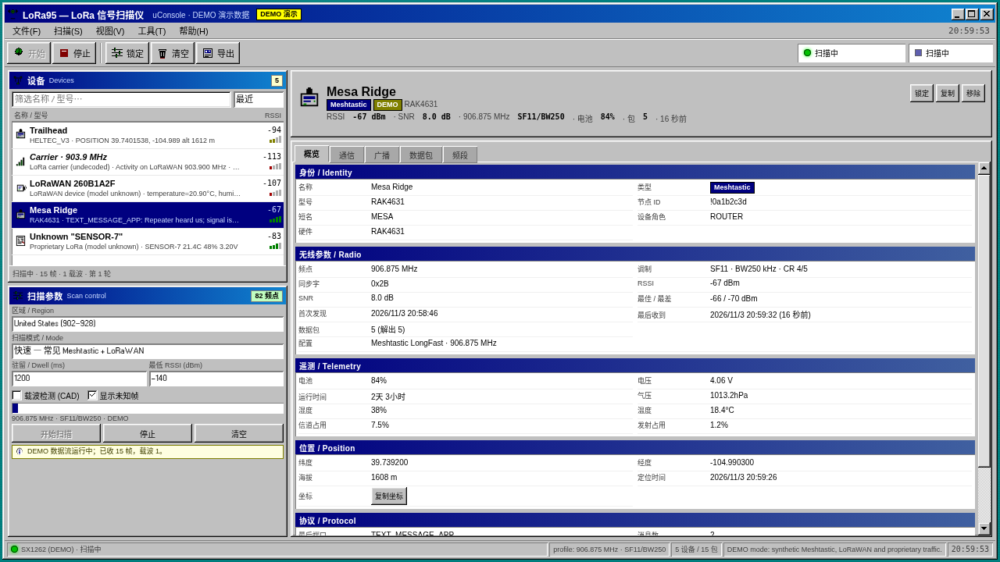
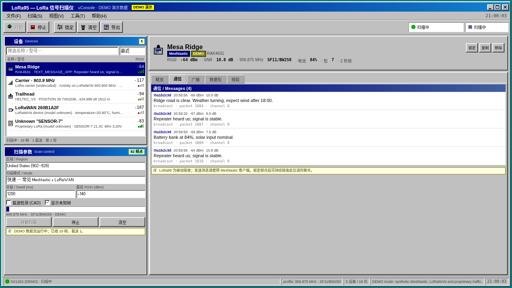
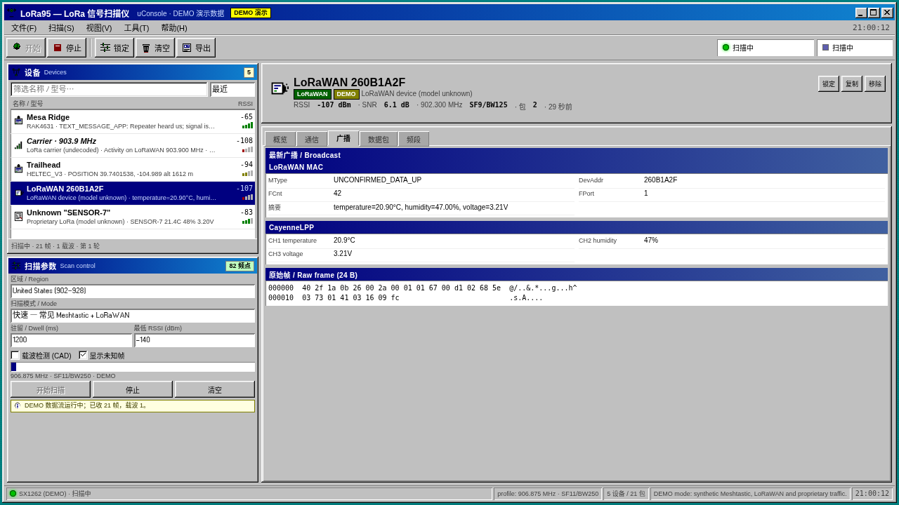
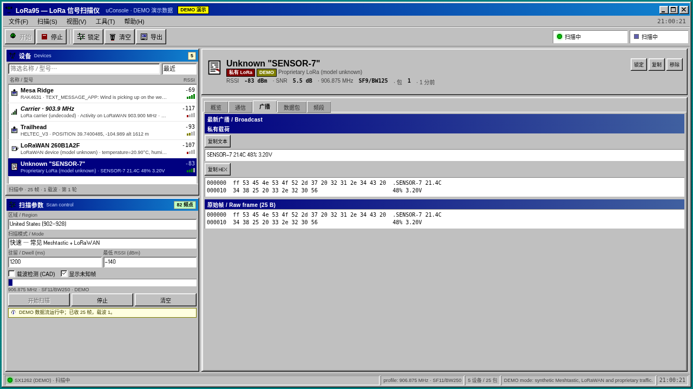
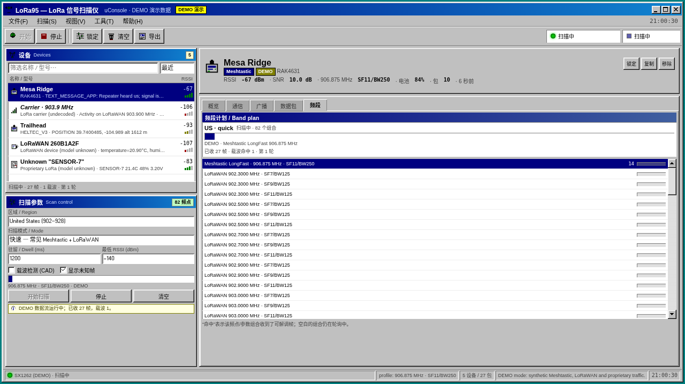

# LoRa95

> **Windows 95 风格的 LoRa 被动扫描器**，为 ClockworkPi uConsole + HackerGadgets AIO v2 编写。



*界面截图使用内置 DEMO 数据（黄标 `DEMO 演示`），不包含任何真实节点或位置。*

LoRa95 把 uConsole 上的 SX126x 变成一台“LoRa 信号扫描仪”：按区域计划轮询
Meshtastic、LoRaWAN 和私有 LoRa 的常见频点/参数，解出能解的内容，并把
无法解调的载波也显示出来。界面是 Windows 95 风格，专为 1280×720 的
uConsole 屏幕排版。

---

## 功能

- **Windows 95 界面**：98.css + W95FA 像素字体，标题栏、菜单、工具栏、
  状态栏、选项卡、对话框、窗口按钮，全部为 1280×720 手工排版。
- **左侧设备列表**：Meshtastic 节点、LoRaWAN 设备、私有 LoRa 帧、仅载波
  信号分别用不同图标/颜色标识；可按最近、RSSI、名称、包数排序与筛选。
- **左下扫描参数区**：区域、扫描模式、驻留时间、最低 RSSI、CAD、自定义
  频率/SF/带宽/编码率/同步字/前导码，以及开始/停止/清空按钮。
- **右侧详情**：选中设备后显示身份、型号、协议、RSSI/SNR、频点/SF/BW、
  首次/最后发现、遥测、位置、坐标复制、原始帧十六进制。
  - Meshtastic：节点名、硬件型号、角色、MAC、公钥、消息列表、位置/遥测广播。
  - LoRaWAN：DevAddr、DevEUI/JoinEUI、FCnt、FPort、ADR/ACK、MIC、
    CayenneLPP 传感器读数、原始帧。
  - 私有 LoRa：ASCII/JSON/十六进制广播内容、长度、指纹。
  - 仅载波：频点/SF/BW/RSSI，说明“检测到能量但当前参数下无法解调”。
- **频段页**：当前扫描计划、进度、每一组频点/参数的命中次数。
- **可锁定频点**：对选中设备“锁定”，停止轮询并持续监听该配置（适合看
  Meshtastic 聊天或某个 LoRaWAN 传感器的连续上报）。
- **持久化/导出**：设备与数据包保存到 SQLite；支持 JSON/CSV 导出。
- **不干扰原系统**：扫描时暂停 `meshtasticd`，退出/停止时自动恢复；
  systemd 的 `ExecStopPost` 兜底，即使守护进程崩溃也不会把 meshtasticd
  留在停止状态。

### 截图

| 概览 | 通信 |
| --- | --- |
|  |  |

| LoRaWAN 广播 | 私有 LoRa |
| --- | --- |
|  |  |

| 频段计划 |
| --- |
|  |

---

## 先说清楚：为什么不能“一键发现所有 LoRa 设备”

这不是软件偷懒，而是 LoRa 物理层的性质：

1. **没有广播式发现机制。** Wi-Fi/蓝牙有 beacon/广告包；LoRa 没有。接收机
   必须和发射端使用相同的 **频率、带宽（BW）、扩频因子（SF）、编码率（CR）
   和同步字（Sync Word）** 才能解调。一次只能锁定一组参数。
2. **没有 MAC 地址/设备名。** LoRa 帧本身不携带“我是谁”。只有上层协议
   （Meshtastic 的 NodeInfo、LoRaWAN 的 DevAddr/DevEUI）才可能提供身份；
   私有协议只能看到原始字节。
3. **不发射就发现不了。** 被动接收机无法探测“沉默”的设备。
4. **加密内容不可读。** Meshtastic 自定义 PSK、LoRaWAN 的 AppSKey/NwkSKey
   不在接收端，能看到的只有 MAC 元数据和密文。

LoRa95 的处理方式：

- **按计划轮询**：Meshtastic 常用预设（LongFast/LongSlow/MediumFast/...）、
  LoRaWAN 的上行信道（US 902.3–903.9、500k 信道、EU868、AS923 等）、
  以及可选的私有频段。
- **CAD 载波检测**：对无法解调的频点做 Channel Activity Detection，至少把
  “这里有 LoRa 能量”显示为载波对象。
- **尽力解码**：Meshtastic 默认 PSK（`AQ==`）可解密并显示节点名/消息；
  LoRaWAN 可解析 MAC 层与 CayenneLPP；其他协议显示原始帧。
- **明确标注**：加密、候选（直接寻址的 Meshtastic 帧）、私有、仅载波，
  不会把猜测伪装成事实。

---

## 硬件

目标机：ClockworkPi uConsole（CM4，Debian 13 trixie）+ HackerGadgets AIO v2。

| 项目 | 值 |
| --- | --- |
| LoRa 芯片 | Semtech SX126x（AIO v2 板载，`spidev1.0`） |
| SPI | SPI1 CE0（`dtoverlay=spi1-1cs`） |
| BUSY | GPIO24 |
| RESET | GPIO25 |
| DIO1 | GPIO26 |
| DIO2 | RF switch（`DIO2_AS_RF_SWITCH: true`） |
| DIO3 | 1.8 V TCXO（`DIO3_TCXO_VOLTAGE: true`） |
| 电源轨 | GPIO16（AIO v2 `LORA` rail，`pinctrl set 16 op dh`） |
| 现有 LoRa 栈 | `meshtasticd`（占用同一 SPI/GPIO） |

驱动是独立 Python 实现：直接发 SX126x SPI 命令，GPIO 用 `lgpio`，不使用
RadioLib/Meshtastic 的代码。读取命令的“一个 dummy 字节”时序在
`app/radio.py` 里有注释（写错会让所有状态字错位）。

---

## 目标机上发现并修复的问题

### 1. meshtasticd 的频率槽配置错误（已修复）

这是本次任务里最实质的 LoRa 配置 bug。

- `v2.7.26` 的 `meshtasticd` 启动日志显示：

  ```text
  Radio freq=902.125
  Set radio: region=US, name=LongFast, config=0, ch=0, power=30
  ```

- 但 US 的 **LongFast 默认频率是 906.875 MHz**（`hash("LongFast") % 104 = 19`，
  `902 + 0.125 + 19×0.25 = 906.875`）。`meshtastic --get lora.channel_num`
  返回 `1`，即强制使用 0 号槽（902.125 MHz），而不是默认槽 19。
- 后果：节点在一个几乎没人使用的频点上待了 9 天，NodeDB 里只有自己。
- 修复：

  ```bash
  meshtastic --host 127.0.0.1 --set lora.channel_num 0
  ```

  配置备份在 `/root/meshtastic-prefs-backup-20261103-202354/`。
- 验证：

  ```text
  Radio freq=906.875
  Set radio: region=US, name=LongFast, config=0, ch=19, power=30
  channel_num: 20
  frequency: 906.875000
  ```

  `meshtastic --get lora.channel_num` 现在返回 `0`。

> 如果本地 mesh 确实约定使用 1 号槽，可以改回：
> `meshtastic --host 127.0.0.1 --set lora.channel_num 1`。

### 2. SPI/GPIO 争用（LoRa95 负责协调）

`meshtasticd` 和 LoRa95 不能同时操作 `spidev1.0`。LoRa95 在开始扫描时：

1. 记录 meshtasticd 是否在运行（`/run/lora95/meshtasticd_was_active`）；
2. `systemctl stop meshtasticd`，等待 SPI 释放；
3. 打开 SX126x 扫描；
4. 停止扫描/退出时 `systemctl start meshtasticd`。

systemd 单元的 `ExecStopPost=restore-meshtastic.sh` 会在崩溃/被杀时兜底恢复。
这解决的是“LoRa 软硬件配套”的互斥问题，而不是改 meshtasticd 本身。

### 3. 电源轨开关的副作用（规避）

`aiov2_ctl LORA on/off` 会顺带 stop/start `meshtasticd`，在扫描过程中调用会
把电台从 LoRa95 手里抢走。LoRa95 直接用 `pinctrl set 16 op dh` 打开电源轨，
不经过 `aiov2_ctl`。

### 4. 说明：芯片版本字符串

驱动读回的版本字符串是 `SX1261 V2D 2D02`（SX1261/2 共用硅片标识），
AIO v2 商品页和 meshtasticd 配置都写的是 SX1262。LoRa95 是**纯接收**应用，
不配置 PA、不发送，所以版本字符串不影响扫描。它也不依赖 meshtasticd 的
`Module: sx1262` 配置。

### 5. 修复效果

频率槽改回 `channel_num: 0` 并重启 meshtasticd 后，NodeDB 从“只有自己”
变成能看到附近 **10 个以上** Meshtastic 节点（`meshtastic --nodes`），
证明 902.125 MHz 确实是之前收不到任何节点的原因。

实测 LoRa95 的接收链路：在 906.875 MHz / SF11 / BW250 / Sync 0x2B 上收到
一帧 97 字节的广播帧，RSSI **-96 dBm**、SNR **-17 dB**；同一配置下
meshtasticd 也能看到这些节点。说明频率修复 + 扫描配置是正确的。

---

## 安装

### 依赖

目标机（Debian 13）通常已带这些包：

```bash
sudo apt install python3-flask python3-cryptography python3-spidev python3-lgpio
```

还需要 `pinctrl`（Raspberry Pi OS 自带）、`chromium`、`curl`、`xfce4-screenshooter`
（可选，仅截图用）。

### 安装到 /opt

```bash
git clone https://github.com/Alexljz789/lora95.git
cd lora95
sudo ./scripts/install.sh
```

安装脚本会：

- 把程序复制到 `/opt/lora95`；
- 安装 `lora95-radio.service`（root）和 `lora95-web.service`（用户 alex）；
- 在 `~/Desktop` 和 `~/.local/share/applications` 创建 **LoRa95** 快捷方式；
- 安装 `/usr/local/bin/lora95-ui` 启动器；
- 写入仅允许 start/stop LoRa95 两个服务的 sudoers 规则。

服务**不会**设为开机自启：桌面快捷方式按需启动，关闭窗口时停止并恢复
meshtasticd。

### 手动运行（开发）

```bash
cd lora95
python3 -m app.web --demo --port 8767   # 无需硬件，DEMO 数据
# 或真实硬件：
sudo systemctl start lora95-radio.service
python3 -m app.web --port 8766
```

打开 `http://127.0.0.1:8766`。开发时也可直接启动 `app.daemon`：

```bash
sudo env PYTHONPATH=$PWD python3 -m app.daemon --socket /tmp/lora95.sock
```

### 卸载

```bash
sudo ./scripts/uninstall.sh          # 保留用户配置/数据库
sudo ./scripts/uninstall.sh --purge  # 一并删除
```

---

## 使用

1. 双击桌面 **LoRa95**。Chromium 以 kiosk 模式打开 1280×720 界面；启动后会
   自动开始扫描（可在 `~/.config/lora95/config.json` 里设 `"auto_scan": false`
   关闭）。
2. 左下选择区域（默认 US）和扫描模式；点 **开始**。
3. 左侧出现设备后点选：
   - **概览**：身份/型号/无线参数/遥测/位置；
   - **通信**：Meshtastic 文本消息（被动接收）；
   - **广播**：最新载荷、解析结果、原始帧；
   - **数据包**：历史帧，点行看详情；
   - **频段**：扫描计划与每个组合的命中次数。
4. 想持续盯住某个设备，点详情右上角的 **锁定**；停止扫描可恢复轮询。
5. **导出** 工具栏按钮导出 JSON；菜单里还有 CSV。

### 扫描模式

| 模式 | 内容 | 大约组合数（US） |
| --- | --- | --- |
| 快速 Quick | Meshtastic 常用预设 + LoRaWAN 常见上行 + 少量私有频点 | 82 |
| 标准 Standard | 全部 LoRaWAN 上行 + 0.8 MHz 私有子频段 | 336 |
| 深度 Deep | 0.2 MHz 步进 × SF7–12 + 全部预设/信道名变体 | 1041 |
| 载波 Survey | 仅 CAD，快速找“有能量”的频点 | 416 |
| 自定义 Custom | 单频点/SF/BW/CR/Sync | 1 |

默认驻留 1.2 s；收到帧后会多停留 0.45 s（最多 3×驻留）以接住后续包。
`载波检测 (CAD)` 打开时，每个组合先做一次 CAD；只有 RSSI 在 -120…
-20 dBm 之间才记一条载波对象，避免把噪声当地址。

---

## 架构

```text
                 SPI1 / GPIO24/25/26
  SX126x  <--------------------------------+
                                            |
  app/radio.py  (SX126x driver)             |
        ^                                   |
  app/scanner.py (profile scan, CAD)        |
        ^                                   |
  app/daemon.py  (root, /run/lora95/radio.sock)  <-- JSON lines -->
        ^                                                        |
  app/web.py (Flask, user alex)  <-- SSE/fetch --> Chromium UI   |
        ^                                                        |
  app/store.py (SQLite)  <-- app/classify.py / meshtastic.py / lorawan.py / cayenne.py
```

- **无线电守护进程**（root）：只发原始帧事件，不解析协议；负责停/启
  meshtasticd、电源轨、Unix socket 权限。
- **Web 进程**（alex）：解析、持久化、SSE、REST API、导出。
- **UI**：无外部 CDN，98.css/W95FA 本地化，离线可用。
- 扫描参数、设备、消息、原始帧都可以在 `/api/state`、`/api/device/<id>`
  看到，方便二次开发。

### 解码细节

- **Meshtastic**：16 字节头 + AES-256-CTR；nonce =
  `packet_id(LE32) || from(LE32) || 8×0`；默认 PSK `0x01` 经 SHA-256。
  `Data` protobuf 手写 wire-format 解析（不依赖 protobuf 生成代码）。
  NodeInfo/Position/Telemetry/Text/Routing/NeighborInfo/Traceroute 等。
- **LoRaWAN**：JoinRequest/JoinAccept/Data Up/Down 的 MAC 层字段；不尝试
  解密或校验 MIC（没有会话密钥）。CayenneLPP 支持温度/湿度/电压/GPS 等。
- **私有**：ASCII/JSON/十六进制；按 `(profile, length, first 4 bytes)` 指纹
  聚成“未知设备”，避免把每次变化都当成新设备。

---

## 开发与测试

```bash
python3 -m unittest discover -s tests -v
```

测试覆盖 Meshtastic 编解码（含真实抓到的直接寻址候选帧）、LoRaWAN/CayenneLPP、
私有帧、ASCII 误判防护、频率计划、SQLite 持久化。

生成图标：

```bash
python3 tools/make_icon.py
```

---

## 限制与隐私

- **只接收，不发射。** 程序不会抢占信道发送任何帧；Meshtastic 的发送请用原客户端。
- 不访问网络、不上传数据、不写位置到外部服务；SQLite 只在本机
  `~/.local/share/lora95/`。
- Meshtastic 默认 PSK 是公开的；自定义 PSK 的频道只能看到密文。
- LoRaWAN 没有会话密钥，因此只显示 MAC 元数据；不要把它当作协议分析仪。
- 请遵守所在地区的 ISM 频段法规。
- DEMO 截图/数据是合成的；仓库不包含真实坐标、节点名或截图。

---

## License

MIT。第三方组件见 [THIRD_PARTY_NOTICES.md](THIRD_PARTY_NOTICES.md)。

---

## English summary

LoRa95 is a Windows 95 styled, receive-only LoRa scanner for the ClockworkPi
uConsole with HackerGadgets AIO v2. It cycles through Meshtastic presets,
LoRaWAN uplink channels and private-LoRa profiles, decodes default-PSK
Meshtastic and LoRaWAN MAC/CayenneLPP frames, exposes undecodable carriers via
CAD, and shows everything in a 1280×720 Win95 UI. It temporarily stops
`meshtasticd` while scanning and restores it on exit. It also fixed a real
target bug: meshtasticd was pinned to frequency slot 1 (902.125 MHz) instead of
the US LongFast default (906.875 MHz). Not affiliated with Meshtastic or the
LoRa Alliance.
